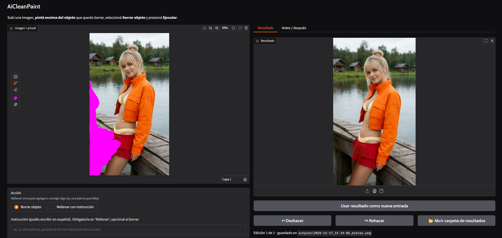
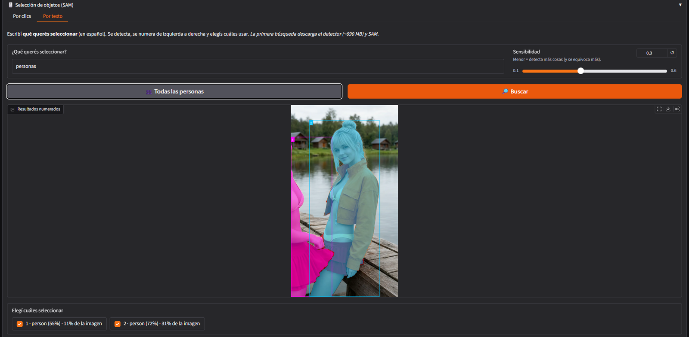

<p align="center">
  
</p>

<h1 align="center">AiCleanPaint</h1>

Borra objetos y personas de una imagen, y rellena o corrige zonas con IA generativa. Es una alternativa tipo [IOPaint](https://github.com/Sanster/IOPaint) basada en **Qwen-Image-2.1**, con interfaz web (Gradio) y pincel.

Funciona en **Windows y Linux** y está ajustada para una **GPU de 12 GB** (probada en RTX 3060).

<p align="center">
  
</p>

<p align="center"><em>Pintás el objeto (en magenta) y el comparador muestra el antes y el después.<br>Imagen de ejemplo.</em></p>

## Características

- **Borrar objeto:** pintás encima de lo que sobra y el modelo reconstruye el fondo.
- **Rellenar con instrucción:** pintás una zona y describís qué debe aparecer (por ejemplo, una parte que falta).
- **Solo cambia lo que pintás:** el resultado se pega únicamente dentro de la máscara, con borde suavizado. El resto de la imagen queda intacto.
- **Edición por recorte:** solo se procesa la zona alrededor de la máscara, así se mantiene la resolución original y se ahorra memoria.
- **Cuantización a 4 bits (NF4)** y offload a CPU para entrar en 12 GB de VRAM.
- **Modo rápido (LaMa, opcional, apagado por defecto):** para borrar cosas chicas o fondos simples en pocos segundos, sin cargar Qwen. Ver más abajo.
- **Selección de objetos (opcional, apagada por defecto):** por **clics** (SAM 2.1 genera la máscara y los clics siguientes la refinan) o por **texto** en español ("personas", "perro"...), con los resultados numerados para elegir cuáles usar. Ver más abajo.
- **Comparador antes / después:** pestaña con una línea que sigue al cursor y revela la imagen original a un lado y el resultado al otro. Tiene un botón **⛶** (o doble clic sobre la imagen) para verlo en **pantalla completa**; con **Esc** se sale.
- **Guardado automático:** cada resultado se guarda en `outputs/` como PNG sin pérdida, con fecha y hora en el nombre y los parámetros usados embebidos en el archivo.
- **Historial con Deshacer / Rehacer:** volvé a cualquier versión anterior de una cadena de ediciones y seguí desde ahí (hasta 30 versiones por sesión).
- Encadenado de ediciones con el botón "Usar resultado como nueva entrada".

## Capturas

**Borrar un objeto, con historial y guardado automático.** El resultado se guarda en `outputs/` y se puede volver atrás con Deshacer / Rehacer.



**Seleccionar por texto.** Escribís qué querés seleccionar (en español), se detectan y numeran los resultados de izquierda a derecha, y elegís cuáles usar.



## Requisitos

- GPU NVIDIA con 12 GB de VRAM o más (recomendado).
- 32 GB de RAM recomendados (parte del modelo se mueve a la memoria del sistema).
- Unos 35 GB libres de disco para el modelo.
- Python 3.10 o superior y Git.

Configuración con la que se probó: Windows, Python 3.13, `torch 2.11.0+cu128`, RTX 3060 de 12 GB.

## Instalación

### Instalación automática (recomendada)

```bash
git clone https://github.com/Ferreyrajp/AiCleanPaint.git
cd AiCleanPaint
```

Después ejecutá el instalador de tu sistema:

| Sistema | Comando |
|---|---|
| Windows | `setup.bat` (o doble clic) |
| Linux | `./setup.sh` (si dice *Permission denied*: `chmod +x setup.sh run.sh`) |

El instalador:

1. Busca un Python 3.10 o superior y crea el entorno virtual `.venv`.
2. Detecta tu GPU NVIDIA con `nvidia-smi` y elige la **build de PyTorch que corresponde a tu driver** (`cu128` para drivers con CUDA 12.8 o más, `cu126` para 12.6 y 12.7).
3. Instala `torch` y `torchvision` **juntos desde el mismo índice** (instalarlos por separado puede dejar torchvision en versión CPU) y reemplaza una build de PyTorch incorrecta si ya había una.
4. Instala el resto de las dependencias (`requirements.txt`).
5. Corre un diagnóstico (`check_env.py`) y te dice qué está bien y qué falta.

Es seguro volver a ejecutarlo: lo que ya está bien se conserva.

Opciones útiles (se pasan al final del comando, por ejemplo `setup.bat --cuda cu126`):

| Opción | Qué hace |
|---|---|
| `--cuda cpu\|cu126\|cu128\|cu130` | Forzar la build de PyTorch en vez de la automática. |
| `--download-model` | Descargar ya el modelo (~33 GB) en `models/`, con barra de progreso, en vez de esperar al primer uso. |
| `--recreate` | Borrar y recrear el entorno `.venv` desde cero. |
| `--skip-torch` / `--skip-deps` | Saltear la instalación de PyTorch o de las dependencias. |
| `--check` | Solo diagnosticar el entorno existente. |
| `--dry-run` | Mostrar los comandos sin ejecutar nada. |

Si algo falla, ejecutá `python check_env.py` (con el entorno activado) y pegá la salida completa al pedir ayuda.

> **Nota:** ya no hace falta tener `git` para instalar `diffusers`: desde la versión 0.43 el pipeline de Qwen-Image-2.1 viene en PyPI. `git` solo se usa para clonar este repositorio.

### Instalación manual

Si preferís hacerlo a mano:

```bash
python -m venv .venv
# Linux:   source .venv/bin/activate
# Windows: .venv\Scripts\activate

# 1) PyTorch y torchvision con CUDA (elegí tu versión de CUDA en https://pytorch.org/get-started/locally/)
pip install torch torchvision --index-url https://download.pytorch.org/whl/cu128

# 2) El resto de dependencias
pip install -r requirements.txt
```

> Instalá `torch` y `torchvision` **desde el mismo índice de CUDA**. Si instalás torchvision sin él, pip puede traer una versión de CPU.

## Uso

```bat
run.bat          &:: Windows
```
```bash
./run.sh         # Linux (si no ejecuta: chmod +x run.sh)
```

También se puede lanzar directamente con `python app.py`. Se abre el navegador en `http://127.0.0.1:7860`.

Opciones:

| Opción | Descripción |
|---|---|
| `--quant nf4` (por defecto) | Cuantización de 4 bits. Recomendada para 12 GB. |
| `--quant int8` | Algo más de calidad, usa más VRAM. |
| `--quant none` | Sin cuantizar (necesita mucha más VRAM). |
| `--offload model` (por defecto) | Mueve componentes a la CPU cuando no se usan. |
| `--offload sequential` | Más lento, pero usa menos VRAM. Útil si hay errores de memoria. |
| `--model RUTA` | Usar una copia local del modelo. |
| `--port`, `--host` | Puerto y dirección del servidor. Sin `--port` se usa el primero libre desde 7860. |
| `--share` | Link público temporal de Gradio. |
| `--lama-device auto\|cpu\|cuda` | Dispositivo del modo rápido (LaMa). Por defecto `auto`: GPU si hay, y si falta memoria pasa a CPU. |
| `--sam-device cpu\|cuda` | Dispositivo para SAM y el detector por texto. Por defecto `cpu`. |
| `--no-browser` | No abrir el navegador automáticamente. |

**Importante:** la primera vez que apretás el botón, se descargan los pesos (unos 33 GB) a la carpeta `models/` del proyecto y luego se cargan en memoria. Tarda bastante; las siguientes veces solo carga.

## Cómo se usa

### Borrar un objeto

1. Subí la imagen.
2. Elegí la acción **Borrar objeto**.
3. Pintá con el pincel **toda** la zona (incluyendo sombras y bordes) y un poco por fuera.
4. Apretá **Ejecutar**.

### Modo rápido con LaMa (opcional)

Está **apagado por defecto**: mientras no lo actives, la pantalla y el comportamiento son los de siempre.

1. En **Ajustes**, marcá *Habilitar modo rápido (LaMa) para borrar*. Aparece el selector **Motor** junto a *Acción*.
2. Elegí **Rápido (LaMa)** y usá la app igual que siempre: pintás (o seleccionás con SAM) y apretás **Ejecutar**. El resultado pasa por el mismo historial, comparador y guardado en `outputs/` (el archivo termina en `_borrar-lama.png`).
3. La primera vez descarga el modelo (~200 MB, licencia Apache-2.0) a `models/`. **No se carga Qwen**, así que no esperás su carga ni usás su VRAM.

Cuándo conviene cada motor:

| | Rápido (LaMa) | Calidad (Qwen) |
|---|---|---|
| Sirve para | Detalles chicos o medianos sobre fondos regulares: cables, textos, manchas, objetos pequeños | Objetos grandes, personas, escenas complejas |
| Entiende instrucciones | No | Sí |
| Inventa estructura nueva | No: con zonas grandes deja texturas borrosas o repetidas | Sí |

«Rellenar con instrucción» **siempre usa Qwen**, aunque elijas Rápido. Si el resultado rápido no te convence, cambiá a Calidad y volvé a ejecutar (con Deshacer volvés atrás).

Seguridad: el modelo es un archivo TorchScript (formato basado en pickle). Por eso la app descarga una versión fija del repositorio y **verifica su hash SHA-256 antes de cargarlo**; si no coincide, no lo abre. En una GPU con poca memoria libre, LaMa cae solo a la CPU (`--lama-device cpu|cuda|auto` para elegir).

### Seleccionar objetos (opcional)

Está **apagada por defecto**: mientras no la actives, la app no descarga ni carga nada extra.

En **Ajustes**, marcá *Habilitar selección de objetos (SAM 2.1)* y elegí los tamaños de los modelos. Aparece la sección *Selección de objetos* con dos pestañas. Cada modelo se descarga a `models/` recién la primera vez que lo usás.

#### Pestaña «Por clics»

1. Subí tu imagen al editor y apretá **1 · Cargar imagen del editor**.
2. **Hacé clic sobre el objeto.** Con más clics de tipo *Incluir (+)* o *Excluir (−)* corregís la selección. Si no es la máscara que querías, probá *Máscara sugerida* 1, 2 o 3.
3. Apretá **3 · Usar esta máscara**: pasa al editor como capa pintada. Retocala con el pincel si hace falta (SAM recorta el objeto, pero normalmente **no incluye su sombra proyectada**; pintala o subí «Agrandar máscara») y apretá **Ejecutar**.

#### Pestaña «Por texto»

1. Escribí qué querés seleccionar, **en español** (por defecto `personas`), o apretá **👥 Todas las personas**. Podés separar varias cosas con comas: `perro, botella`.
2. Apretá **🔎 Buscar**. El texto se traduce al inglés (las palabras comunes con un diccionario interno, el resto con el traductor), se detectan los objetos con Grounding DINO y SAM dibuja la máscara de cada uno. Los resultados aparecen **numerados de izquierda a derecha**.
3. Marcá o desmarcá los que querés (por ejemplo, dejá solo el nº 1 para borrar a la persona de la izquierda) y apretá **Usar la selección**: pasa al editor como capa pintada.

Consejos: funciona mejor con sustantivos comunes (`persona`, `perro`, `auto`, `botella`). Frases relativas como "la de la izquierda" o "la del vestido rojo" son poco fiables: buscá `personas` y elegí por número. Si no encuentra nada, bajá la **sensibilidad**; si detecta de más, subila.

#### Tamaños de descarga (aproximados)

- SAM 2.1: `tiny` ~155 MB, `small` ~200 MB (recomendado), `base-plus` ~336 MB, `large` ~900 MB.
- Detector por texto (Grounding DINO): `tiny` ~690 MB (recomendado), `base` ~930 MB. Son estimaciones a partir de la cantidad de parámetros en fp32; confirmalas en la página de cada modelo.

Ambos modelos corren en la CPU por defecto para no competir por VRAM con Qwen (`--sam-device cuda` para usar la GPU). Requieren una versión de `transformers` reciente (`pip install -U transformers`). Licencias: SAM 2.1 y Grounding DINO usan Apache-2.0.

### Agregar o corregir algo

1. Elegí **Rellenar con instrucción**.
2. Pintá la zona donde debe aparecer lo nuevo e incluí algo de la zona vecina para dar continuidad.
3. Describí qué debe aparecer, en español o inglés. Por ejemplo: `su otra pierna, parada de forma natural junto a la otra, mismo tono de piel e iluminación`. Si escribís en español se traduce automáticamente al inglés (podés revisar el resultado en "Instrucción enviada al modelo" o desactivar la traducción en Ajustes).
4. Apretá **Ejecutar**. Si no convence, cambiá la semilla en Ajustes.

Después de "Usar resultado como nueva entrada" hay que volver a pintar: el pincel se reinicia.

### Historial y resultados guardados

- Cada edición se guarda en `outputs/AAAA-MM-DD_HH-MM-SS_borrar.png` (o `_rellenar`). Los parámetros quedan dentro del PNG (campo `parameters`).
- **↶ Deshacer / ↷ Rehacer** cargan la versión anterior o siguiente directamente en el editor. Si editás desde una versión anterior, las posteriores se descartan.
- Si subís otra imagen, empieza un historial nuevo. El historial vale por sesión: al cerrar la app se pierde, pero los archivos de `outputs/` quedan.
- La carpeta `outputs/` no se limpia sola. Podés desactivar el guardado en Ajustes.

## Ajustes

| Ajuste | Para qué sirve |
|---|---|
| Pasos | Más pasos suelen dar mejor calidad pero tardan más. |
| Resolución del recorte | Tamaño máximo de la zona que se envía al modelo. Bajalo si te quedás sin VRAM. |
| Contexto | Cuánta imagen alrededor de la máscara ve el modelo. |
| Agrandar máscara | Ayuda a cubrir sombras y bordes del objeto. |
| Suavizado del borde | Mezcla más natural entre lo nuevo y la imagen original. |
| Semilla | Cambiala si el resultado no convence. |
| Modo de máscara | `overlay` (zona resaltada en magenta, por defecto) o `reference` (máscara como segunda imagen). |

## Cómo funciona

1. Se calcula el rectángulo alrededor de la máscara, con contexto, y se recorta.
2. En modo `overlay`, la zona se pinta de magenta y se le pide al modelo que la quite o la reemplace. En modo `reference`, la máscara se envía como segunda imagen.
3. Qwen-Image-2.1 genera el recorte editado.
4. Se pega **solo dentro de la máscara**, con el borde suavizado, sobre la imagen original.

El resaltado es magenta (y no rojo) porque casi no aparece en fotos reales y no se confunde con ropa, flores u otros objetos.

## Problemas comunes

| Problema | Solución |
|---|---|
| `Qwen3VLVideoProcessor requires the Torchvision library` | Ejecutá `setup.bat` / `./setup.sh` otra vez (instala torch y torchvision juntos), o instalá torchvision desde el mismo índice de CUDA que torch. |
| El instalador dice que el driver es viejo | Actualizá el driver de NVIDIA (se necesita CUDA 12.6 o superior) y volvé a ejecutarlo. |
| `./setup.sh: Permission denied` | `chmod +x setup.sh run.sh` |
| Quiero comprobar si todo está bien | `python check_env.py` (con el entorno activado) o `setup.bat --check`. |
| `CUDA out of memory` | Usá `--offload sequential`, bajá la resolución del recorte y cerrá otros programas que usen la GPU. |
| `broken PNG file` / "La imagen del editor llegó dañada" | Quitá la imagen con la ✕ del editor y volvé a cargarla. Al iniciar, la app limpia su carpeta temporal `.gradio_tmp/`; si persiste, cerrá y reabrí la app. |
| `Cannot find empty port` | Hay otra instancia abierta (ciérrala) o el puerto está reservado por Windows. Con la versión actual se elige un puerto libre automáticamente. |
| El editor queda en "Cargando..." | Refrescá con Ctrl+F5 y cerrá otras pestañas con la app abierta. |
| `SAM 2` no se encuentra / `cannot import Sam2Model` | Actualizá transformers: `pip install -U transformers`. |
| Los clics no marcan donde hice clic | Cargá de nuevo la imagen con «1 · Cargar imagen del editor» (si cambiaste el tamaño del modelo hay que volver a cargarla). |
| «Por texto» no encuentra lo que escribí | Bajá la sensibilidad, probá otro término (más simple, en singular) o usá el detector `base` en Ajustes. |
| «Por texto» detecta cosas de más | Subí la sensibilidad y desmarcá los resultados que no quieras. |
| El modo rápido deja una zona borrosa o con texturas repetidas | Es el límite de LaMa con zonas grandes o complejas: usá el motor «Calidad (Qwen)». |
| «Modo rápido (LaMa): … no coincide con el hash esperado» | La descarga quedó dañada. Borrá la carpeta `models/hub/models--JosephCatrambone--big-lama-torchscript` y volvé a probar. |
| La selección con clic es lenta | Usá `tiny`/`small`, o `--sam-device cuda` si te sobra VRAM. |
| Queda una mancha magenta o garabatos al borrar algo muy pequeño | Las zonas diminutas usan un relleno clásico (OpenCV, instalalo con `pip install opencv-python-headless`). Ajustá el umbral en Ajustes. Si el modelo deja magenta, la app reintenta con otra semilla y, si falla, usa ese relleno. |
| Quedan restos del objeto | Pintá más superficie (con sombras) o subí "Agrandar máscara". |
| El modelo reemplaza el objeto por otra cosa | Escribí en Instrucción qué debe quedar (ej. `rellená con el muelle de madera y el agua del lago`), probá otra semilla o el modo `reference`. |
| Queda color magenta en el resultado | Subí "Agrandar máscara" y volvé a ejecutar. |
| Aviso de Hugging Face sobre peticiones sin autenticar | Es opcional. Podés definir `HF_TOKEN` para descargas más rápidas. |
| Todavía descarga en `C:` y no en `models/` | Revisá si tenés definida la variable de entorno `HF_HOME`: si existe, tiene prioridad. |

## Estructura

```
app.py            Interfaz Gradio
eraser_core.py    Carga del modelo, recorte, inferencia y pegado
history.py        Guardado automático e historial deshacer/rehacer
lama_inpaint.py   Modo rápido: LaMa (descarga verificada por hash, opcional)
segmenter.py      Envoltorio de SAM 2.1 (clics y cajas, opcional)
click_select.py   Lógica de clics incluir/excluir y máscara final
detector.py       Detección por texto con Grounding DINO (opcional)
text_select.py    Selección por texto: etiquetas, numeración y elección
mask_tools.py     Vista previa, limpieza y conversión de máscaras
compare_view.py   Comparador antes/después
translate.py      Traducción español → inglés de la instrucción
requirements.txt  Dependencias (torch se instala aparte)
run.bat / run.sh  Lanzadores de la app para Windows y Linux
setup.bat / setup.sh  Instalación automática (usan install.py)
install.py        Instalador: entorno, PyTorch según tu CUDA, dependencias
check_env.py      Diagnóstico del entorno
models/           Pesos descargados (no se sube a Git)
outputs/          Resultados guardados (no se sube a Git)
```

## Limitaciones

- Es más lento que métodos clásicos como LaMa.
- Rellenar partes complejas (por ejemplo anatomía) puede requerir varias semillas.
- El modelo se controla con instrucciones, no con una máscara nativa; por eso hay dos modos de indicar la zona.
- Se probó en una sola configuración de hardware y software (ver Requisitos).

## Licencias

- **Código de este repositorio:** [licencia MIT](LICENSE). Vale solo para el código de este proyecto, no para los modelos que usa.
- **Qwen-Image-2.1:** se distribuye bajo la **Qwen Research License**. Esa licencia no es Apache/MIT y limita ciertos usos, entre ellos el comercial. Revisá el texto oficial antes de usarlo con fines comerciales. Los pesos **no están incluidos** en este repositorio; se descargan desde Hugging Face.
- **SAM 2.1**, **Grounding DINO** (selección de objetos) y **LaMa** (modo rápido), todos opcionales: licencia Apache-2.0. Los pesos tampoco se incluyen.

### Atribución y aviso legal

> **Built with Qwen.** Qwen is licensed under the Qwen RESEARCH LICENSE AGREEMENT, Copyright (c) 2026 Hangzhou Tongyi Laboratory Technology Co., Ltd. All Rights Reserved.
>
> AiCleanPaint es un proyecto independiente y no oficial: no está afiliado ni respaldado por Alibaba ni por el equipo de Qwen. "Qwen" y "Qwen-Image-2.1" se mencionan solo para indicar el modelo en el que se basa. Este repositorio no incluye ni modifica los pesos del modelo.

## Créditos

- [Qwen-Image-2.1](https://github.com/QwenLM/Qwen-Image-2.1), de Alibaba / Qwen.
- Inspirado en [IOPaint](https://github.com/Sanster/IOPaint).
- Construido con [Diffusers](https://github.com/huggingface/diffusers), [Gradio](https://www.gradio.app) y bitsandbytes.
