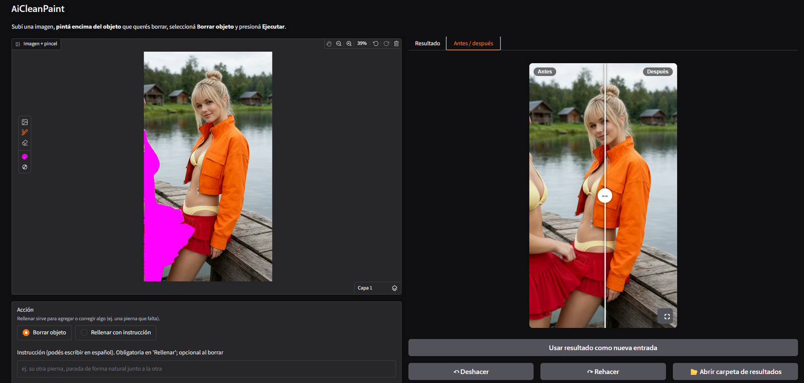

# AiCleanPaint

Borra objetos y personas de una imagen, y rellena o corrige zonas con IA generativa. Es una alternativa tipo [IOPaint](https://github.com/Sanster/IOPaint) basada en **Qwen-Image-2.1**, con interfaz web (Gradio) y pincel.

Funciona en **Windows y Linux** y está ajustada para una **GPU de 12 GB** (probada en RTX 3060).

<!--
Agregá capturas en la carpeta assets/ y descomentá:

-->

## Características

- **Borrar objeto:** pintás encima de lo que sobra y el modelo reconstruye el fondo.
- **Rellenar con instrucción:** pintás una zona y describís qué debe aparecer (por ejemplo, una parte que falta).
- **Solo cambia lo que pintás:** el resultado se pega únicamente dentro de la máscara, con borde suavizado. El resto de la imagen queda intacto.
- **Edición por recorte:** solo se procesa la zona alrededor de la máscara, así se mantiene la resolución original y se ahorra memoria.
- **Cuantización a 4 bits (NF4)** y offload a CPU para entrar en 12 GB de VRAM.
- Encadenado de ediciones con el botón "Usar resultado como nueva entrada".

## Requisitos

- GPU NVIDIA con 12 GB de VRAM o más (recomendado).
- 32 GB de RAM recomendados (parte del modelo se mueve a la memoria del sistema).
- Unos 35 GB libres de disco para el modelo.
- Python 3.10 o superior y Git.

Configuración con la que se probó: Windows, Python 3.13, `torch 2.11.0+cu128`, RTX 3060 de 12 GB.

## Instalación

```bash
git clone https://github.com/Ferreyrajp/AiCleanPaint.git
cd AiCleanPaint

python -m venv .venv
# Linux:   source .venv/bin/activate
# Windows: .venv\Scripts\activate

# 1) PyTorch y torchvision con CUDA (elegí tu versión de CUDA en https://pytorch.org/get-started/locally/)
pip install torch torchvision --index-url https://download.pytorch.org/whl/cu128

# 2) El resto de dependencias
pip install -r requirements.txt
```

> Instalá `torch` y `torchvision` **desde el mismo índice de CUDA**. Si instalás torchvision sin él, pip puede traer una versión de CPU.

## Uso

```bat
run.bat          &:: Windows
```
```bash
./run.sh         # Linux (si no ejecuta: chmod +x run.sh)
```

También se puede lanzar directamente con `python app.py`. Se abre el navegador en `http://127.0.0.1:7860`.

Opciones:

| Opción | Descripción |
|---|---|
| `--quant nf4` (por defecto) | Cuantización de 4 bits. Recomendada para 12 GB. |
| `--quant int8` | Algo más de calidad, usa más VRAM. |
| `--quant none` | Sin cuantizar (necesita mucha más VRAM). |
| `--offload model` (por defecto) | Mueve componentes a la CPU cuando no se usan. |
| `--offload sequential` | Más lento, pero usa menos VRAM. Útil si hay errores de memoria. |
| `--model RUTA` | Usar una copia local del modelo. |
| `--port`, `--host` | Puerto y dirección del servidor. |
| `--share` | Link público temporal de Gradio. |
| `--no-browser` | No abrir el navegador automáticamente. |

**Importante:** la primera vez que apretás el botón, se descargan los pesos (unos 33 GB) a la carpeta `models/` del proyecto y luego se cargan en memoria. Tarda bastante; las siguientes veces solo carga.

## Cómo se usa

### Borrar un objeto

1. Subí la imagen.
2. Elegí la acción **Borrar objeto**.
3. Pintá con el pincel **toda** la zona (incluyendo sombras y bordes) y un poco por fuera.
4. Apretá **Ejecutar**.

### Agregar o corregir algo

1. Elegí **Rellenar con instrucción**.
2. Pintá la zona donde debe aparecer lo nuevo e incluí algo de la zona vecina para dar continuidad.
3. Describí en inglés qué debe aparecer, por ejemplo: `her left leg, standing naturally next to the other leg, same skin tone and lighting`.
4. Apretá **Ejecutar**. Si no convence, cambiá la semilla en Ajustes.

Después de "Usar resultado como nueva entrada" hay que volver a pintar: el pincel se reinicia.

## Ajustes

| Ajuste | Para qué sirve |
|---|---|
| Pasos | Más pasos suelen dar mejor calidad pero tardan más. |
| Resolución del recorte | Tamaño máximo de la zona que se envía al modelo. Bajalo si te quedás sin VRAM. |
| Contexto | Cuánta imagen alrededor de la máscara ve el modelo. |
| Agrandar máscara | Ayuda a cubrir sombras y bordes del objeto. |
| Suavizado del borde | Mezcla más natural entre lo nuevo y la imagen original. |
| Semilla | Cambiala si el resultado no convence. |
| Modo de máscara | `overlay` (zona resaltada en magenta, por defecto) o `reference` (máscara como segunda imagen). |

## Cómo funciona

1. Se calcula el rectángulo alrededor de la máscara, con contexto, y se recorta.
2. En modo `overlay`, la zona se pinta de magenta y se le pide al modelo que la quite o la reemplace. En modo `reference`, la máscara se envía como segunda imagen.
3. Qwen-Image-2.1 genera el recorte editado.
4. Se pega **solo dentro de la máscara**, con el borde suavizado, sobre la imagen original.

El resaltado es magenta (y no rojo) porque casi no aparece en fotos reales y no se confunde con ropa, flores u otros objetos.

## Problemas comunes

| Problema | Solución |
|---|---|
| `Qwen3VLVideoProcessor requires the Torchvision library` | Instalá torchvision desde el mismo índice de CUDA que torch (ver Instalación). |
| `CUDA out of memory` | Usá `--offload sequential`, bajá la resolución del recorte y cerrá otros programas que usen la GPU. |
| El editor queda en "Cargando..." | Refrescá con Ctrl+F5 y cerrá otras pestañas con la app abierta. |
| Quedan restos del objeto | Pintá más superficie (con sombras) o subí "Agrandar máscara". |
| El modelo reemplaza el objeto por otra cosa | Escribí en Instrucción qué debe quedar (ej. `fill with the wooden pier and the lake water`), probá otra semilla o el modo `reference`. |
| Queda color magenta en el resultado | Subí "Agrandar máscara" y volvé a ejecutar. |
| Aviso de Hugging Face sobre peticiones sin autenticar | Es opcional. Podés definir `HF_TOKEN` para descargas más rápidas. |
| Todavía descarga en `C:` y no en `models/` | Revisá si tenés definida la variable de entorno `HF_HOME`: si existe, tiene prioridad. |

## Estructura

```
app.py            Interfaz Gradio
eraser_core.py    Carga del modelo, recorte, inferencia y pegado
requirements.txt  Dependencias (torch se instala aparte)
run.bat / run.sh  Lanzadores para Windows y Linux
models/           Pesos descargados (no se sube a Git)
```

## Limitaciones

- Es más lento que métodos clásicos como LaMa.
- Rellenar partes complejas (por ejemplo anatomía) puede requerir varias semillas.
- El modelo se controla con instrucciones, no con una máscara nativa; por eso hay dos modos de indicar la zona.
- Se probó en una sola configuración de hardware y software (ver Requisitos).

## Licencias

- **Código de este repositorio:** definí aquí la licencia que elijas (por ejemplo MIT).
- **Qwen-Image-2.1:** se distribuye bajo la **Qwen Research License**. Esa licencia no es Apache/MIT y limita ciertos usos, entre ellos el comercial. Revisá el texto oficial antes de usarlo con fines comerciales. Los pesos **no están incluidos** en este repositorio; se descargan desde Hugging Face.

## Créditos

- [Qwen-Image-2.1](https://github.com/QwenLM/Qwen-Image-2.1), de Alibaba / Qwen.
- Inspirado en [IOPaint](https://github.com/Sanster/IOPaint).
- Construido con [Diffusers](https://github.com/huggingface/diffusers), [Gradio](https://www.gradio.app) y bitsandbytes.
